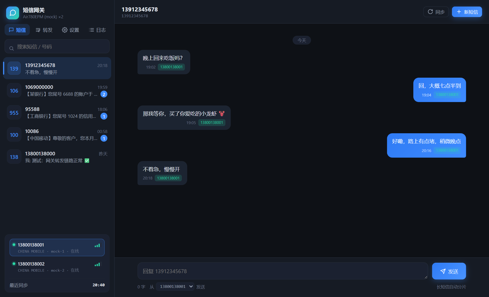
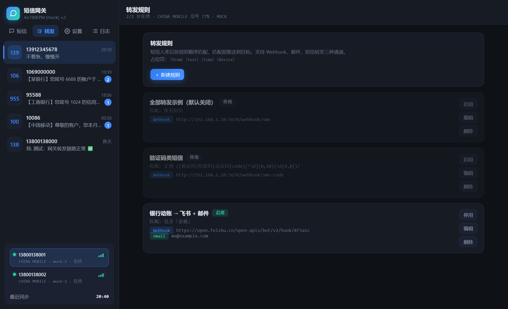
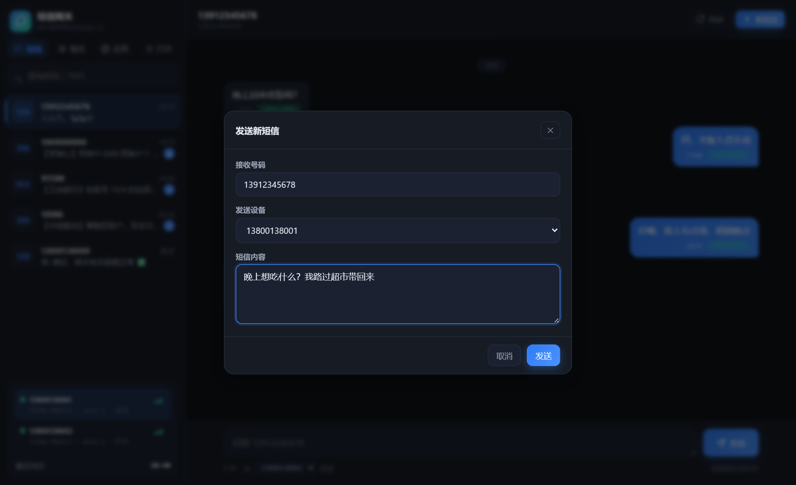
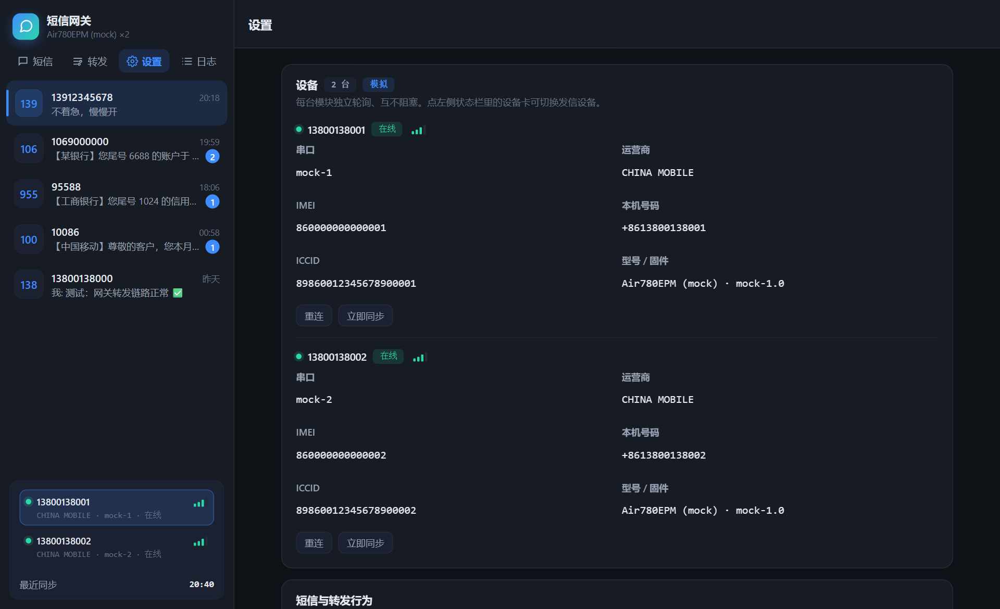
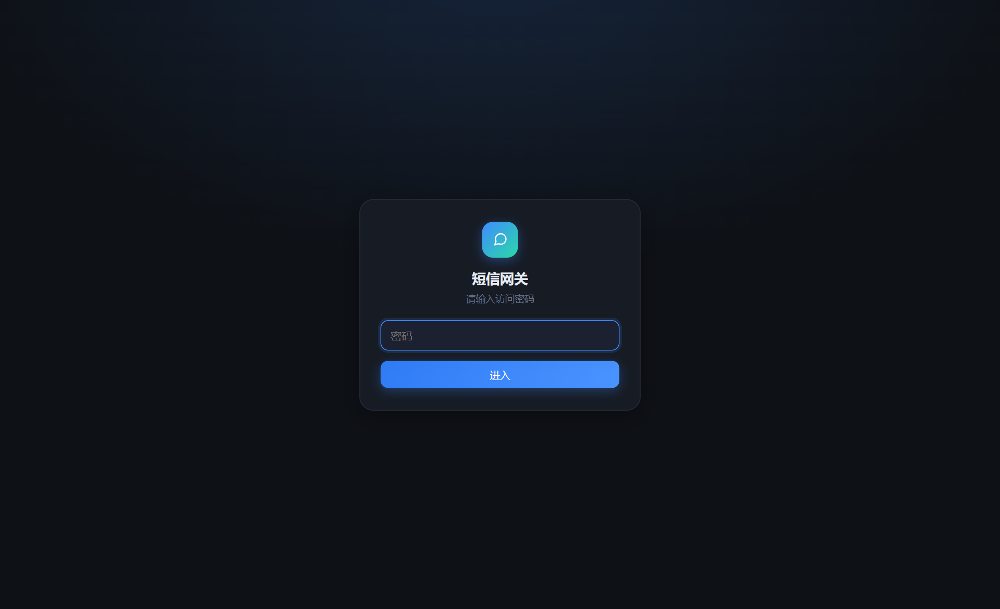
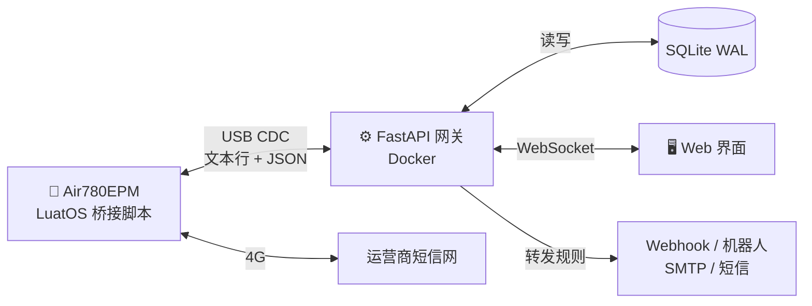

<div align="center">

# 短信网关

**把插在 NAS 上的 4G 模块，变成一个只属于你的短信网关。**
收发、会话、转发全部在本地跑，短信不出你家门。


[快速开始](#快速开始) · [界面](#界面) · [功能](#功能) · [架构](#架构) · [文档](#文档) · [常见问题](#常见问题)

<a href=".github/assets/screenshots/inbox.png">
  
</a>

</div>

---

## 这是什么

一张闲置的 4G 卡 + 一块合宙 **Air780EPM** + 一台常开的 NAS，就能有一个**完全自持**的短信通道：

- **收**：验证码、银行动账、快递通知，Web 界面按会话聚合，不用翻手机
- **发**：网页直接发短信，长短信自动分片，多张卡可以选从哪张发
- **转**：按号码 / 关键词 / 正则匹配，自动推到 Webhook、飞书/钉钉机器人、邮件，或转发到另一张卡
- **不留痕**：没有第三方云、没有中转服务器，SQLite 就在你自己的硬盘上

典型用法：把收验证码的副卡插进去，验证码自动推到群机器人；或者给家里的老人留一个能收短信的固定号码。

## 界面

<table>
<tr>
<td width="50%"><br><sub><b>转发规则</b> —— 匹配方式、目标通道、启停一目了然</sub></td>
<td width="50%"><br><sub><b>发送</b> —— 多设备时可以选择从哪张卡发出</sub></td>
</tr>
<tr>
<td width="50%"><br><sub><b>设备面板</b> —— 串口、IMEI、ICCID、信号、固件版本</sub></td>
<td width="50%"><br><sub><b>访问密码</b> —— Bearer Token，30 天有效</sub></td>
</tr>
</table>

> 截图使用 `MODEM_MOCK=1` 的模拟数据生成，界面与真实运行一致。

## 功能

| 模块 | 说明 |
|---|---|
| 短信收发 | PDU 编解码，中文、emoji、长短信自动分片与合并 |
| 会话视图 | 按号码聚合、未读计数、搜索、手动标记已读 |
| 转发规则 | 所有 / 包含 / 正则 / 号码匹配 → Webhook、邮件、短信转发 |
| 实时推送 | WebSocket 推新短信与模块状态，无需刷新 |
| 多设备 | 按 IMEI 收敛身份，插几台认几台，热插拔自愈 |
| 模块面板 | 信号、运营商、ICCID、IMEI、在线状态、AT 调试 |
| 认证 | 可选访问密码（Bearer Token，30 天有效） |
| 无硬件模式 | `MODEM_MOCK=1` 用假数据跑通界面和转发，先试后装 |

## 架构



后端 FastAPI + SQLite(WAL) + pyserial，前端零构建（原生 JS + hash 路由），单容器部署。
模块侧与上位机之间是自研的轻量桥接协议：`PING`/`STATUS`/`SEND`/`SETPIN` ↔ `+PONG`/`+STATUS`/`+SMS`/`+SENT`/`+BOOT`。

## 硬件前提

> [!IMPORTANT]
> **Air780EPM 没有 AT 短信固件**，只有 LuatOS 二次开发。
> 必须先给模块烧录 [`firmware/main.lua`](firmware/main.lua) 桥接脚本，
> 短信能力由模块侧 Lua 调用 `sms` 库实现。
> 跳过这一步，网关只会显示「固件没有短信能力」——这不是 bug。

硬件清单：

| 件 | 说明 |
|---|---|
| 合宙 Air780EPM | 4G Cat.1，USB 直插；支持插多块 |
| 已激活的 SIM 卡 | 能收短信即可，语音/流量不需要 |
| 一台常开的 NAS / 小主机 | 能跑 Docker，x86 或 arm64 都行 |
| USB 数据线 | 注意是**数据线**不是纯充电线 |

## 快速开始

```bash
# 1. 初始化：生成 .env（随机密码 + 会话密钥）、建好 data/
./scripts/install.sh

# 2. 给模块烧录桥接脚本 —— 一次性，见 docs/烧录指南.md

# 3. 启动
docker compose up -d --build
docker compose logs -f
```

看到 `[IMEI] 已连接 /dev/ttyACM0 信号 22（88%）中国联通` 就成功了，
浏览器打开 `http://NAS的IP:8080`。`install.sh` 会把登录密码打印出来，记下来。

**没插模块想先看界面**：`.env` 里设 `MODEM_MOCK=1`，重建容器即可，会带几条示例短信。

详细的接线、自检、PIN 卡、反向代理步骤见 [部署指南](docs/部署-飞牛NAS.md)。

## 文档

| 文档 | 内容 |
|---|---|
| [部署 · 飞牛 NAS](docs/部署-飞牛NAS.md) | 硬件接线、安装、自检、启动验证、常见问题、反向代理 |
| [烧录指南](docs/烧录指南.md) | Luatools 建工程、BOOT 模式、固件版本选择、排错、协议速查 |
| [转发规则](docs/转发规则.md) | 匹配方式、模板占位符、各服务配置、errcode 排障 |
| [配置项参考](docs/配置项参考.md) | 全部环境变量、构建参数、pip 源 |
| [多设备](docs/多设备.md) | 分组策略、接口变化、数据库迁移、已知限制 |
| [实测记录](docs/实测记录.md) | 端到端真机验证过程与结论 |
| [CHANGELOG](CHANGELOG.md) | 版本变更 |
| [CONTRIBUTING](CONTRIBUTING.md) | 本地开发与测试 |

## 项目结构

```
sms-gateway/
├── app/                 # FastAPI 后端
│   ├── pdu.py           #   PDU 编解码（GSM7/UCS2/UDH/时区）
│   ├── modem.py         #   AT 驱动 + 端口探测
│   ├── luatos.py        #   LuatOS 桥接驱动
│   ├── device.py        #   多设备发现与身份分组
│   ├── service.py       #   同步、分片聚合、事件广播
│   ├── forwarder.py     #   Webhook / SMTP / 短信转发
│   ├── db.py / api.py / main.py
│   └── static/          #   零构建前端
├── firmware/main.lua    # 烧进模块的 LuatOS 桥接脚本（必刷）
├── scripts/             # install / preflight / probe_* / backup-nas / upgrade
├── docs/                # 专题文档（见上表）
├── tests/               # 8 个自测套件，纯 Python，不依赖硬件
├── Dockerfile
└── docker-compose.yml
```

## 开发与测试

```bash
python -m venv .venv && .venv/Scripts/pip install -r requirements.txt
MODEM_MOCK=1 .venv/Scripts/python.exe -m uvicorn app.main:app --port 8080

for t in pdu luatos phone operator multi pin device forwarder; do
    .venv/Scripts/python.exe -m tests.test_$t
done
```

8 个套件覆盖 PDU 编解码、桥接协议、号码归一化、运营商识别、多设备、SIM PIN、
设备发现、转发通道模板与错误判定。**全部不依赖硬件**，CI 在每次 push 自动跑全套。

## 升级与备份

换版本目录有个坑：compose 数据卷是相对路径 `./data:/data`，新目录直接 `up` 会得到空库。
别手动拷，用脚本：

```bash
./scripts/upgrade.sh --dry-run    # 先看计划
./scripts/upgrade.sh              # 执行：备份 → 复用 .env → data 软链 → 健康检查 → 失败自动回滚
```

日常备份用 `./scripts/backup-nas.sh`，会把代码 + `.env` + 数据库一致快照打包
（SQLite 是 WAL 模式，脚本走 `sqlite3.backup()` 而不是裸 `cp`）。

> 手工升级（不走脚本）时**务必**把旧目录的 `.env` 复制到新目录。
> 发布包只含 `.env.example`，漏了这步 `AUTH_PASSWORD` / `SECRET_KEY` 会变空，
> 登录态全部作废且容器跑的是裸露的默认配置。

## 常见问题

| 现象 | 原因 / 处理 |
|---|---|
| 网页一直显示「等待模块…」 | 先看容器日志有没有 `已连接 /dev/ttyACM*`。浏览器缓存过旧脚本的话按一次 `F5`（1.1.10 起静态资源带版本号，不会再卡缓存） |
| 显示「固件没有短信能力」 | 没刷 `firmware/main.lua`，见[烧录指南](docs/烧录指南.md) |
| 一台模块被识别成三台 | 1.1.3 以前按接口级路径分组。升级到 1.1.3+ 即按 USB 设备级路径分组 |
| 端口从 `ttyACM0` 变成 `ttyACM2` | 正常现象，插拔/重启都会跳。设备按 IMEI 收敛，不影响功能 |
| 转发没收到 | 看日志里的 `errcode`；Webhook 模板占位符见[转发规则](docs/转发规则.md) |
| 升级后要重新登录 | 说明 `.env` 丢了（`SECRET_KEY` 变了），把旧 `.env` 复制回来重建容器 |
| 想从外网访问 | 飞牛 NAS 配反向代理 + HTTPS，不要裸奔 8080 |

## 注意

- 短信内容与链接来自外部，界面已做转义；转发到自建服务时请自行校验。
- 密码、SMTP 授权码存在本地 `data/sms.db`，别把整个目录传到公网。
- `.env` 与 `data/` 不在版本控制内，也**不在发布包内**，升级时务必保留。
- 本项目不做批量群发。用它骚扰别人是滥用，与作者无关。

## 许可证

[MIT](LICENSE) © 2026 caddaric9527
